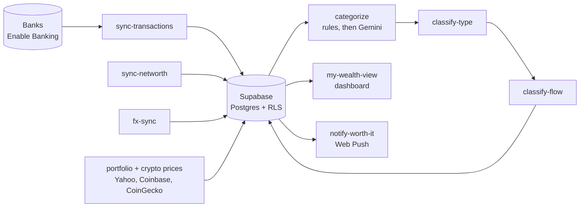

<div align="center">

# 💸 myfinances

**A self-hosted net worth tracker for European bank accounts, brokerage and crypto.**
Your data lives in your own Supabase project. No SaaS, no subscription.

[](https://github.com/marcodonghiaa/myfinances/actions/workflows/test.yml)
[](LICENSE)


</div>

> This repo is the **backend**: sync scripts, Supabase Edge Functions and migrations.
> The dashboard is [**my-wealth-view**](https://github.com/marcodonghiaa/my-wealth-view).

## ✨ Features

| | |
|---|---|
| 🏦 **Bank sync** | PSD2 open banking via [Enable Banking](https://enablebanking.com): Revolut, Wise, Fineco and 2000+ other European banks. Multi-user. |
| 🏷️ **Categorization** | Your own `category_rules` first, Gemini for the rest. Hand-set categories are never overwritten. The Gemini key is recommended but optional: without it, or when Gemini fails, your rules still run. |
| 🔁 **Subscription detection** | Every transaction is marked `Subscription` or `One-time`. |
| 🔀 **Flow detection** | `spend`, `income` or `transfer`, so exchanges and top-ups don't count as income. |
| 📈 **Portfolio and crypto** | Prices from Yahoo Finance, Coinbase (read-only key) and CoinGecko. |
| 💱 **FX** | Daily EUR rates from Frankfurter/ECB, history backfilled on first run. |
| 🔔 **"Worth it?" prompts** | Web Push after discretionary purchases. |

**Trade-offs:** European (PSD2) banks only, and you run the sync yourself (Docker, cron or launchd).

## 🧭 How it works



A sync runs **every 6 hours** (banks typically cap unattended access at about 4 calls a day per account) and loops over every linked user:

1. `sync-transactions.js` pulls new transactions, with a 7-day overlap because banks post late.
2. `sync-networth.js` stores daily account balances.
3. `fx-sync.js` stores daily EUR rates.
4. `categorize.js` applies your rules first, then Gemini.
5. `classify-type.js` marks `Subscription` or `One-time`.
6. `classify-flow.js` marks `spend`, `income` or `transfer`, then pairs each card refund with its original charge (same account, merchant, amount and currency, within 90 days; the merchant of a refund is read from its "Refund from <merchant>" remittance) and marks both `refunded` so neither counts as spend or income.
7. `sync-portfolio-prices.js`, `sync-crypto-coinbase.js`, `sync-crypto-prices.js` price your holdings.

A newly linked bank doesn't wait for the next run: in Docker, every 5 minutes the scheduler syncs banks linked in the last hour that have never synced, then categorizes what arrived. With cron or launchd, run `bash run-daily-sync.sh` once after linking.

`notify-worth-it.js` runs every 30 minutes. Portfolio, crypto and notification scripts are single-user (`USER_ID`); bank sync is multi-user.

Bank linking from the dashboard runs as three Supabase Edge Functions, see [`supabase/functions/README.md`](supabase/functions/README.md).

**Built to keep running:** every outbound call has a 60 s timeout, each scheduled script a 10 minute limit, sync cursors are written atomically (and kept on a volume in Docker), and one user's failing rows can't block anyone else's classification.

## 🚀 Getting started

Want to look first? Try the [live demo](https://myfinancess-view.vercel.app/demo): fake data, no sign-up.

Self-hosting takes about **45 minutes** the first time, most of it waiting on Enable Banking.

### 1. Before you start (about 20 minutes)

| You need | Why | Cost |
|---|---|---|
| [Docker Desktop](https://www.docker.com/products/docker-desktop), [Supabase CLI](https://supabase.com/docs/guides/cli), [Node 22](https://nodejs.org), git | to run the setup and the sync | free |
| A [Supabase](https://supabase.com) account | your database and login | free tier is enough |
| An [Enable Banking](https://enablebanking.com) account | the PSD2 connection to your banks | free for your own accounts |
| A [Gemini API key](https://aistudio.google.com/apikey) | AI categories and subscription detection | free tier; optional but recommended |

Enable Banking is the slow part: create a **Production** application (not Sandbox), download its `.pem` key, then activate it by linking one of your own accounts in their panel. The wizard prints the exact redirect URL to use, so you can also do this while it waits for you.

### 2. Run the wizard (about 15 minutes)

```bash
git clone https://github.com/marcodonghiaa/myfinances.git
git clone https://github.com/marcodonghiaa/my-wealth-view.git
cd myfinances
./setup.sh
docker compose up -d --build
```

It creates or links a Supabase project, applies the schema, deploys the functions, creates your login (the app has no sign-up screen), switches off public sign-ups and writes both `.env` files.

Run `./setup.sh` again any time: it keeps what's in `.env`, asks only for what's missing, and applies new migrations and functions. Forgot your password? `./setup.sh --reset-password`. Check your configuration with `node env-check.js`.

### 3. Link a bank (about 5 minutes)

Open http://localhost:3000, sign in, and use **Connect a bank** on the Accounts page. Balances show at once; with Docker, the last 90 days of transactions arrive within about 5 minutes and are categorized.

Bank access lasts 180 days. Two weeks before it ends the Accounts page shows a **Renew access** banner, and `consent-notice.js` (daily) sends a push 7 days, 1 day and on the day it expires.

<details>
<summary><b>Manual setup</b></summary>

1. Create a Supabase project, then `supabase link --project-ref <ref>` and `supabase db push`.
2. In Enable Banking, create a Production application with redirect URL `https://<ref>.supabase.co/functions/v1/bank-consent-callback` (must match exactly). Activate it by linking one of your own accounts in their panel.
3. Deploy the functions and set `ENABLE_BANKING_APP_ID`, `ENABLE_BANKING_PRIVATE_KEY` and `FRONTEND_URL` as Edge Function secrets.
4. In the dashboard, **Authentication -> Users -> Add user** (tick auto-confirm) to create your login, and put its id in `.env` as `USER_ID`.
5. **Authentication -> Sign In / Providers -> User Signups**: turn off *Allow new users to sign up*. Supabase leaves it on, which lets anyone who finds your project URL create an account.
6. `npm install`, then `cp .env.example .env` and fill it in.

</details>

## 🛠️ Everyday commands

| Task | Command |
|---|---|
| Run a full sync by hand | `bash run-daily-sync.sh` |
| Send "worth it?" prompts now | `bash run-notify.sh` |
| Re-apply changed category rules | `node categorize.js --reapply-rules` |
| Check your `.env` | `node env-check.js` |
| Run the tests | `npm test` |

`--reapply-rules` recategorizes rows the AI or an earlier rule set. Categories you set by hand are never touched (tracked in `transactions.category_source`; categories that predate the column count as hand-set).

## ⏰ Scheduling

Docker runs everything on its own schedule (`scheduler.js`). Without Docker, use cron or launchd:

```cron
0 */6 * * *    cd /path/to/myfinances && bash run-daily-sync.sh
*/30 * * * *   cd /path/to/myfinances && bash run-notify.sh
0 9 * * *      cd /path/to/myfinances && node consent-notice.js
```

## 🗄️ Data model

Every table is Row Level Security scoped to `auth.uid() = user_id`.

| Area | Tables |
|---|---|
| Banking | `accounts`, `transactions` (primary key `(account_uid, entry_reference)`), `net_worth_snapshots`, `fx_rates` |
| Rules | `category_rules`, `subscription_billing_overrides` |
| Investments | `portfolio_holdings` / `portfolio_snapshots`, `crypto_holdings` / `crypto_snapshots` |

The dashboard reads `security_invoker` views such as `v_net_worth_daily`, `v_transactions_eur` and `v_subscriptions`. Schema changes live in [`supabase/migrations`](supabase/migrations).

## 🔒 Security

- `.env`, `*.pem` and `last-sync.json*` are gitignored. The Enable Banking key authenticates your app, so treat it like a password.
- The dashboard only uses the publishable key. The service-role key stays in the sync scripts and Edge Functions.
- A Postgres trigger blocks users from editing bank-sourced columns on `transactions`. Only category, type, flow, split and worth-it fields are writable.
- The bank-linking `state` is a single-use token, not a user id, and error text is never reflected into the redirect.
- Bank text is sent to the LLM as untrusted data, in per-user batches.
- The Coinbase integration uses a read-only key.

## 🤝 Contributing

Tests run on every push and pull request. See [CONTRIBUTING.md](CONTRIBUTING.md).

## 📄 License

[MIT](LICENSE)
